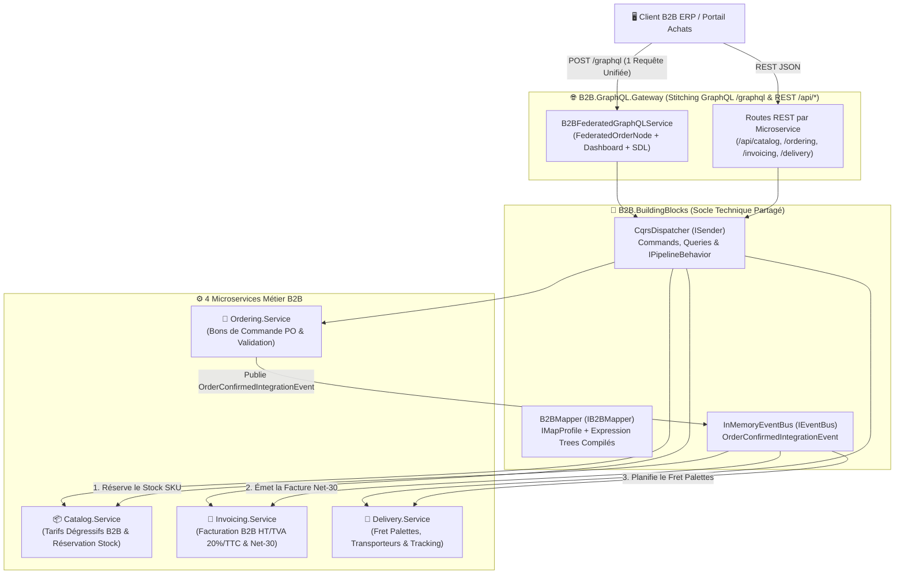

# ✨ B-Lightful Hub — .NET 8 B2B Microservices, CQRS, Compiled Mapper & Federated GraphQL

[](https://dotnet.microsoft.com/)
[](#architecture-microservices--federated-graphql)
[](#federated-graphql-on-microservices)
[](./sonar-project.properties)

**B-Lightful Hub** (*B2B + Delightful*) est une plateforme backend **.NET 8** modulaire illustrant une architecture **Microservices B2B** découplée en **4 contextes bornés (*Bounded Contexts*)** — **Catalog**, **Ordering**, **Invoicing**, **Delivery** — orchestrée par un moteur **CQRS avec Pipeline Behaviors**, un **Object Mapper hybride (Profils typés + Arbres d'Expressions LINQ compilés)**, un **Bus d'Événements d'Intégration (Saga Chorégraphiée)** et une **Passerelle GraphQL Fédérée (`/graphql`)**.

---

## 🏗️ Architecture Microservices & Federated GraphQL



---

## 💡 Pourquoi ces Choix Architecturaux ? (Design Decisions)

### 1. Pourquoi GraphQL au-dessus d'une Architecture Microservices ?
Dans un environnement B2B (portail achats, tableau de bord ERP), l'affichage d'un bon de commande nécessite d'interroger **4 microservices distincts** :
- **`Ordering.Service`** (lignes de commande, société acheteuse, numéro de TVA intracommunautaire),
- **`Catalog.Service`** (poids unitaire, paliers de remise sur volume, disponibilité),
- **`Invoicing.Service`** (facture associée, montant HT / TVA 20% / TTC, échéance Net-30/45),
- **`Delivery.Service`** (calcul du nombre de palettes, transporteur `DHL Global Freight` / `Geodis`, numéro de suivi).

Plutôt que d'imposer 4 appels REST séquentiels au client (*chatty client*), **`B2BFederatedGraphQLService`** expose un graphe unifié (`POST /graphql`) qui résout et assemble (`StitchOrderNodeAsync`) le nœud fédéré `FederatedOrderNode` en **un seul aller-retour HTTP**.

### 2. Pattern CQRS & Pipeline Behaviors (`B2B.BuildingBlocks.Cqrs`)
- Séparation stricte entre les opérations d'écriture (`ICommand<TResponse>`, `ICommandHandler<TCommand, TResponse>`) et de lecture (`IQuery<TResponse>`, `IQueryHandler<TQuery, TResponse>`).
- Support natif des décorateurs transverses via **`IPipelineBehavior<TRequest, TResponse>`** (journalisation d'audit, validation, télémétrie) exécutés autour de chaque handler.

### 3. Object Mapper Hybride : Profils Métier + Arbres d'Expressions Compilés (`B2B.BuildingBlocks.Mapping`)
Le moteur `B2BMapper` (`IB2BMapper`) combine deux approches complémentaires :
1. **Profils de Mapping Explicites (`IMapProfile<TSource, TDestination>`)** : Pour les transformations riches en logique métier (ex: `CatalogProductToDtoProfile` calculant le pourcentage de remise volume B2B et l'alerte de stock bas).
2. **Compilation Dynamique d'Arbres d'Expressions LINQ (`Expression.Lambda<Func<TSource, TDestination>>().Compile()`)** : En l'absence de profil explicite, le mapper génère et met en cache un délégué compilé (supportant les `record` immuables à constructeur primaire ainsi que les classes mutables), garantissant **zéro réflexion à l'exécution** après le premier appel.

### 4. Chorégraphie Événementielle Inter-Microservices (`OrderConfirmedIntegrationEvent`)
Lorsqu'un bon de commande B2B est validé dans `Ordering.Service`, l'événement `OrderConfirmedIntegrationEvent` déclenche automatiquement :
- La décrémentation et réservation du stock dans **`Catalog.Service`**,
- L'émission automatique de la facture B2B (HT + TVA 20% + échéance Net-30/45) dans **`Invoicing.Service`**,
- Le calcul du poids total, du nombre de palettes (`1 palette / 250 kg`), du transporteur et du numéro de tracking dans **`Delivery.Service`**.

---

## 🚀 Démarrage Rapide & Tests

```bash
# Compiler toute la solution (0 Warning SonarAnalyzer.CSharp)
dotnet build BLightfulHub.sln

# Exécuter la suite de tests automatisés xUnit (Unitaires + Saga + GraphQL + REST)
dotnet test BLightfulHub.sln

# Lancer la passerelle GraphQL & REST
dotnet run --project src/Gateway/B2B.GraphQL.Gateway/B2B.GraphQL.Gateway.csproj
```

---

## ⚖️ Usage & Propriété Intellectuelle (Non-Commercial Showcase)

> **Note importante / Portfolio Showcase Notice** :  
> Ce projet a été conçu à titre de **démonstrateur d'architecture logicielle et de vitrine technique (R&D / Portfolio)**. Il est mis à disposition uniquement à des fins d'évaluation technique, d'apprentissage et de démonstration. **Toute exploitation, redistribution ou utilisation à des fins commerciales est strictement interdite** sans l'accord écrit préalable de l'auteur.
>
> *This repository is an engineering & software architecture showcase developed for demonstration, educational, and technical evaluation purposes only. **Any commercial use, resale, or production monetization is strictly prohibited** without prior written authorization from the author.*
